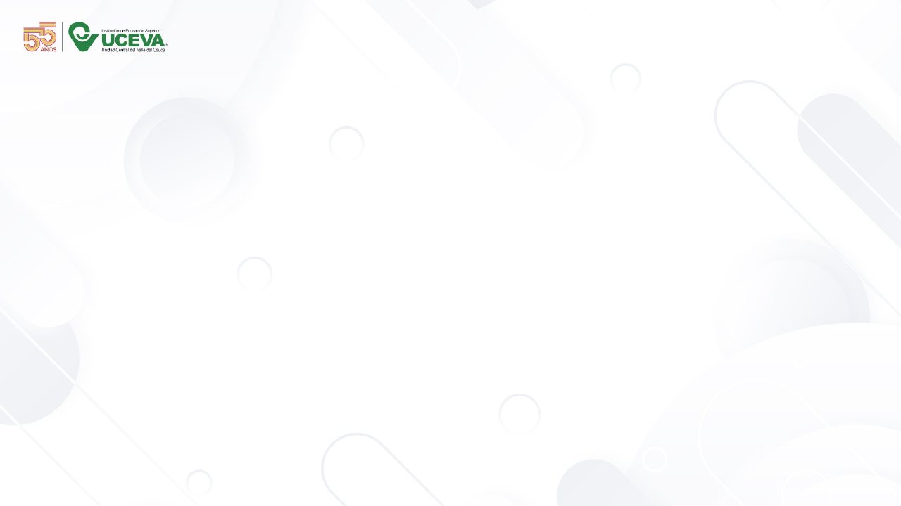
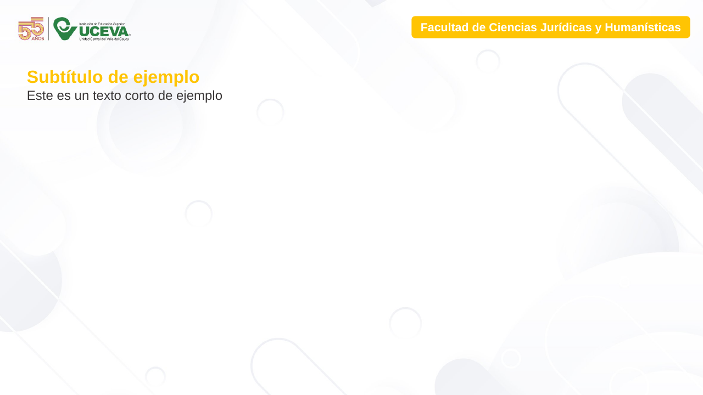
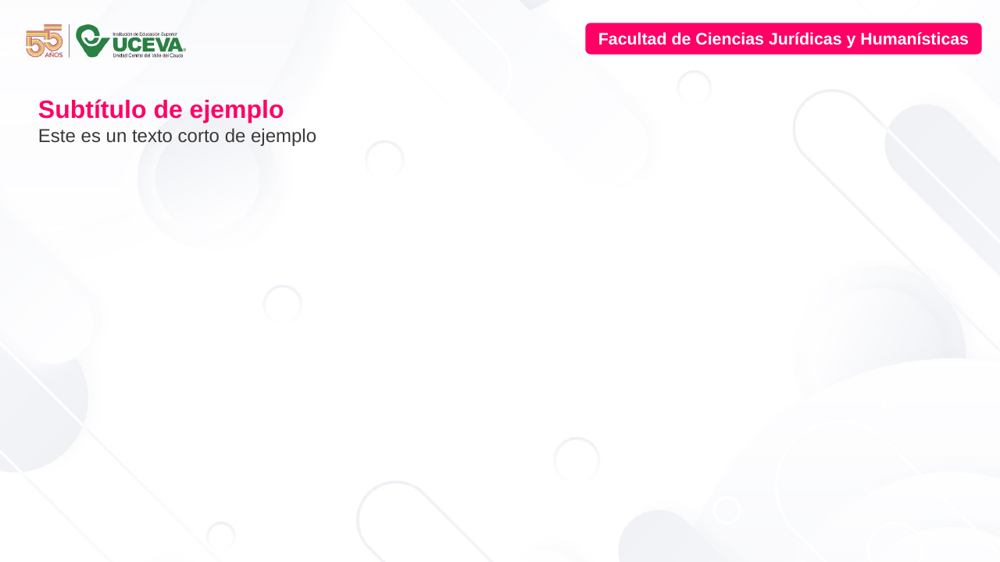
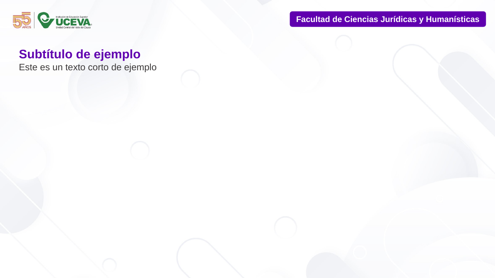
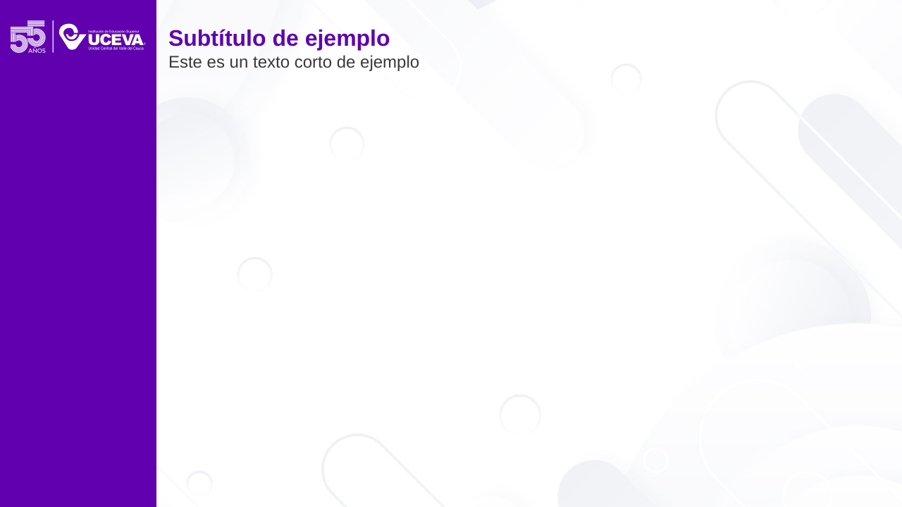
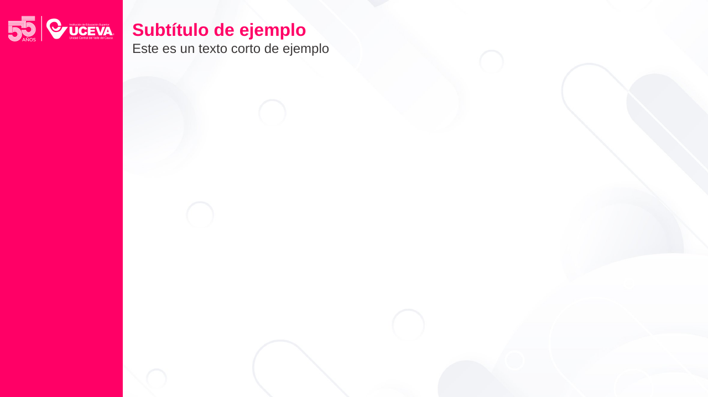
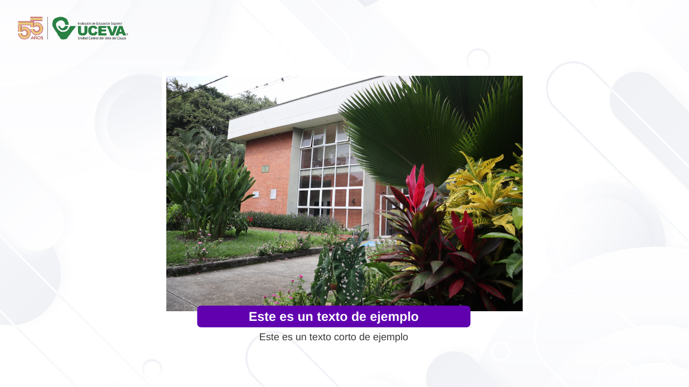
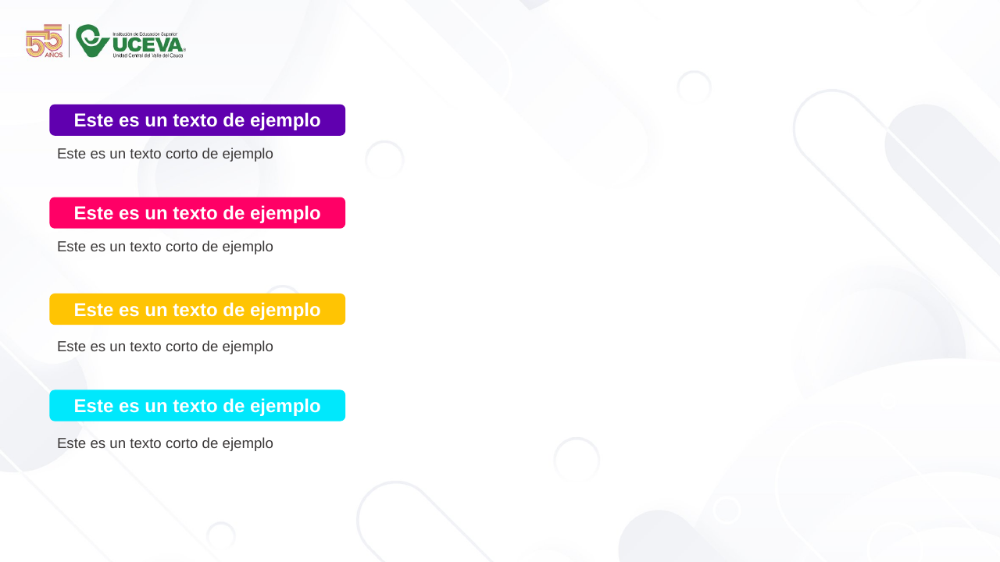
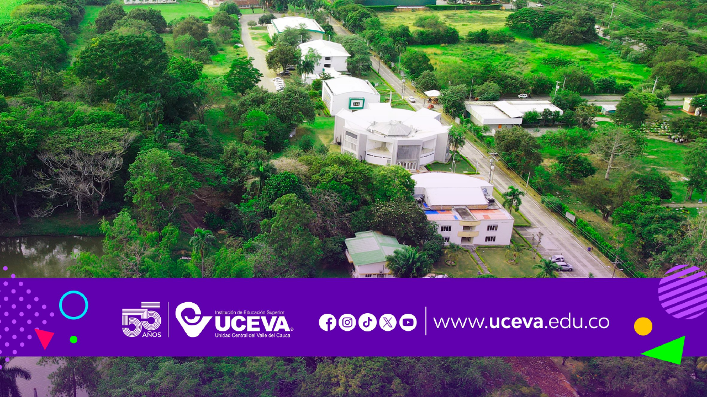

# Catálogo de diapositivas de muestra

La plantilla trae 11 diapositivas de muestra. Aquí está cada una con su vista previa, cuándo usarla,
qué formas tiene y qué función de `lib/uceva_pptx.py` la reproduce.

Notas generales (verificadas en el archivo):

- Todas usan el diseño **"Diapositiva de título"**, salvo la 3, que usa **"En blanco"**. Sus marcadores
  (placeholders) no se usan: todo son cuadros de texto, formas e imágenes.
- El **logo pequeño "55 años | UCEVA" y las figuras grises no son formas**: están dentro de la imagen de
  fondo del patrón (`assets/img/fondo_contenido.jpg`). Las muestras 1, 2, 7, 8 y 11 tienen su propia
  imagen de fondo.
- Medidas: EMU (x, y · ancho × alto) y pulgadas. "Gris" = 3B3838 (Fondo 2 del tema oscurecido al 25 %).
- Los textos de muestra sin tamaño declarado heredan **18 pt** del patrón.
- Los datos completos de cada forma (márgenes internos, sombras, origen de cada color) están en
  `spec/slides.json`.

Para ver todas las funciones en acción: `python ejemplos/ejemplo_todos_los_tipos.py`.

---

## 1. Bienvenida

- **Cuándo**: abrir un evento, una inducción o la primera clase. Sin texto propio.
- **Formas**: ninguna. Fondo propio `assets/img/fondo_bienvenidos.png` (logo grande + arte "Bienvenidos").
- **Función**: `bienvenida(prs)`.

## 2. Portada con título

- **Cuándo**: primera diapositiva de casi cualquier presentación.
- **Fondo propio**: `assets/img/fondo_portada.png` (logo grande arriba a la izquierda y "Bienvenidos" pequeño abajo a la izquierda).
- **Formas**:

| Forma | Tipo | EMU | Pulgadas | Relleno / línea | Texto |
|---|---|---|---|---|---|
| Caja del título | rectángulo redondeado | 5290457, 1483569 · 6615404 × 765110 | 5,786, 1,622 · 7,235 × 0,837 | 6000AF, sin línea | «TÍTULO DE EJEMPLO» Arial Black 32, blanco, centrado, sombra |
| Marco | rectángulo redondeado | 5654350, 1166328 · 6718041 × 1782146 | 6,184, 1,276 · 7,347 × 1,949 | sin relleno; línea 00E8FC 2,25 pt discontinua | — (se sale 0,2" por la derecha a propósito) |
| Subtítulo | cuadro de texto | 6223518, 2292613 · 3564294 × 461665 | 6,806, 2,507 · 3,898 × 0,505 | — | «Subtítulo de ejemplo» Arial 24 negrita 6000AF |

- **Función**: `portada(prs, titulo, subtitulo, autor=None, fecha=None)`. Mejora frente a la muestra:
  el subtítulo es más ancho (llega al margen derecho) y siempre se coloca debajo de la caja del título,
  que crece si el título es largo.

## 3. En blanco

- **Cuándo**: contenido libre sin título (diagrama grande, imagen, actividad).
- **Formas**: ninguna. Fondo del patrón (logo pequeño). Diseño "En blanco".
- **Función**: `diapositiva_en_blanco(prs)` → `(s, area)`; el área empieza debajo del logo.

## 4. Contenido con etiqueta amarilla

| Forma | Tipo | EMU | Pulgadas | Relleno | Texto |
|---|---|---|---|---|---|
| Etiqueta de facultad | rectángulo redondeado | 7136946, 279399 · 4833258 × 382685 | 7,805, 0,306 · 5,286 × 0,419 | FFC403, sin línea | «Facultad de Ciencias Jurídicas y Humanísticas» Arial 16 negrita blanco, sombra |
| Subtítulo + texto | cuadro de texto | 375167, 1101988 · 11159607 × 738664 | 0,41, 1,205 · 12,204 × 0,808 | — | «Subtítulo de ejemplo» Arial 24 negrita **FFC403**; «Este es un texto corto de ejemplo» Arial 18 gris |

- **Función**: `diapositiva_contenido(prs, etiqueta, titulo, color="amarillo")`.
- **Diferencia a propósito**: la librería pone el título en morado y el texto de la etiqueta en gris
  oscuro, porque el amarillo sobre blanco y el blanco sobre amarillo casi no se leen.

## 5. Contenido con etiqueta rosada

Igual que la 4, con relleno de etiqueta **FF0066** y subtítulo en FF0066.

- **Función**: `diapositiva_contenido(prs, etiqueta, titulo, color="rosado")` (el título va en rosado).

## 6. Contenido con etiqueta morada (la principal)

Igual que la 4, con relleno de etiqueta **6000AF** y subtítulo en 6000AF.

- **Cuándo**: la mayoría de diapositivas de contenido.
- **Función**: `diapositiva_contenido(prs, etiqueta, titulo, subtitulo=None)` → `(s, area)`.
  El título queda en x = 0,51" (donde empieza el texto en la muestra: caja en 0,41" + margen 0,1").

## 7. Barra lateral morada

- **Fondo propio**: `assets/img/fondo_barra_lateral.jpg` (las figuras grises, sin logo).

| Forma | Tipo | EMU | Pulgadas | Relleno | Texto / imagen |
|---|---|---|---|---|---|
| Subtítulo + texto | cuadro de texto | 2185305, 281090 · 9530445 × 738664 | 2,39, 0,307 · 10,423 × 0,808 | — | «Subtítulo de ejemplo» Arial 24 negrita 6000AF; texto corto Arial 18 gris |
| Barra | rectángulo | 0, 0 · 2112264 × 6858000 | 0, 0 · 2,31 × 7,5 | 6000AF, sin línea | — |
| Logo blanco | imagen | 141572, 281090 · 1823384 × 432142 | 0,155, 0,307 · 1,994 × 0,473 | — | `assets/img/logo_55_uceva_blanco.png` |

- **Cuándo**: portadilla de sección o mensaje destacado.
- **Función**: `diapositiva_barra_lateral(prs, titulo, subtitulo=None, color="morado")` → `(s, area)`.

## 8. Barra lateral rosada

Igual que la 7, con barra y subtítulo en **FF0066**.

- **Función**: `diapositiva_barra_lateral(prs, titulo, color="rosado")`.

## 9. Foto con pie

| Forma | Tipo | EMU | Pulgadas | Estilo | Texto / imagen |
|---|---|---|---|---|---|
| Foto | imagen | 2907506, 1303337 · 6376988 × 4251325 | 3,18, 1,425 · 6,974 × 4,649 | borde blanco 6 pt; sombra exterior (4 pt, 3 pt, 45°, negro 40 %) | `assets/img/foto_ejemplo_campus.jpeg` |
| Etiqueta del pie | rectángulo redondeado | 3489746, 5416715 · 4833258 × 382685 | 3,816, 5,924 · 5,286 × 0,419 | 6000AF, sin línea | «Este es un texto de ejemplo» Arial 18 negrita blanco, sombra |
| Texto debajo | cuadro de texto | 4221325, 5818515 · 3370100 × 307777 | 4,616, 6,363 · 3,686 × 0,337 | — | «Este es un texto corto de ejemplo» Arial 14 gris, centrado |

- **Cuándo**: una foto protagonista (lugar, evento, resultado visual).
- **Función**: `diapositiva_foto(prs, ruta_imagen, pie, texto=None)`. La foto se encaja sin deformarse.

## 10. Lista de bloques

Cuatro pares etiqueta + texto en x = 603933 (0,66"):

| Bloque | Etiqueta (rect. redondeado 3607340 × 382685 · 3,945" × 0,419") | Texto (3370100 × 307777 · 3,686" × 0,337") |
|---|---|---|
| 1 | y 1272553 (1,392"), relleno 6000AF | y 1722374 (1,884") |
| 2 | y 2405066 (2,63"), relleno FF0066 | y 2854889 (3,122") |
| 3 | y 3581096 (3,916"), relleno FFC403 | y 4074451 (4,456") |
| 4 | y 4757126 (5,202"), relleno 00E8FC | y 5250183 (5,742") |

Etiquetas: «Este es un texto de ejemplo» Arial 18 negrita blanco con sombra. Textos: «Este es un texto
corto de ejemplo» Arial 14 gris.

- **Cuándo**: objetivos, pasos, características: ideas cortas con nombre.
- **Función**: `diapositiva_lista_de_bloques(prs, [(etiqueta, texto), …], titulo=None, imagen_derecha=None)`.
  Acepta 1-8 bloques (5-8 en dos columnas). En amarillo y cian la librería usa texto gris oscuro.

## 11. Cierre

- **Formas**: ninguna. Fondo propio `assets/img/fondo_cierre.png`: foto aérea del campus y banda morada
  (de y = 5,243" a 6,72") con el logo, iconos de redes y www.uceva.edu.co.
- **Cuándo**: última diapositiva.
- **Función**: `cierre(prs, texto_principal="¡Gracias!", texto_secundario=None)`. Pone el texto en una
  capa morada al 85 % de opacidad, encima de la foto y lejos de la banda.

---

## Diseños (layouts) del archivo

El archivo trae los 11 diseños estándar de Office (ver `spec/layouts.json`). Solo se usan dos:
"Diapositiva de título" (índice 0) y "En blanco" (índice 6). Todos heredan el fondo del patrón con el logo.
